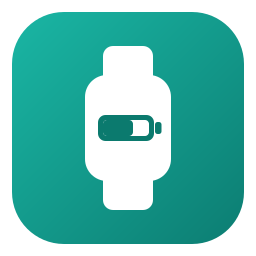

# myXplora — Home Assistant integration

A custom integration that supervises Xplora® watches via **passive** polling of
the cloud API. It reads each watch's last self-reported `WatchLastLocate`
snapshot — it never sends an active locate/track command — so it stays well
clear of the rate-limiting/IP-ban that retired the original `xplora_watch`
integration. See the [repository README](https://gitlab.com/erik.osvaldsson/ha-xplora)
for installation, configuration, and the full rationale.

## Entities (per watch)

| Entity | Platform | Source field |
| ------ | -------- | ------------ |
| Battery | sensor (%) | `battery` |
| Charging | binary_sensor | `isCharging` |
| Online | binary_sensor (connectivity) | `watches.onlineStatus` |
| Steps | sensor | `step` |
| Distance | sensor (m) | `distance` |
| In safe zone | binary_sensor | `isInSafeZone` |
| Safe zone | sensor | `safeZoneLabel` |
| Locate type | sensor | `locateType` (GPS/WIFI/LBS) |
| Location reported | sensor (timestamp) | `tm` |
| Battery reported | sensor (timestamp) | `batteryTm` |
| Location | device_tracker | `lat`/`lng`/`rad` |

The location is **last-known**, not a live fix (a live fix would need an active
locate, which we deliberately avoid). It can be 15–35 min stale.

Each watch is one HA device named `<watch> Watch <model>` (e.g. `Alex Watch
XGO3`), so entity ids include the model — e.g. `binary_sensor.alex_watch_xgo3_charging`.
The device page also shows manufacturer, model, and firmware version.

## Install

Install via [GPM](https://github.com/tomasbedrich/gpm) (recommended), HACS
(custom repository `https://github.com/erikosvaldsson/ha-xplora`), or copy
`custom_components/myxplora/` into your HA `config/custom_components/` and
restart. See the [repository README](https://gitlab.com/erik.osvaldsson/ha-xplora)
for full steps.

Then **Settings → Devices & Services → Add Integration → myXplora**, and sign
in with the same account you use in the Xplora app (email *or* phone + country
code). Scan interval defaults to 90 min and is adjustable in the integration's
options (floor 30 min — keep it slow on purpose).

## Notes

- Auth uses the current Xplora **V2** app key/host (the library's bundled key is
  dead). If logins start failing with `invalid_auth`, the key was likely
  rotated and will need to be re-extracted and updated in `_v2.py`.
- Unofficial, reverse-engineered client for personal use with your own account.
